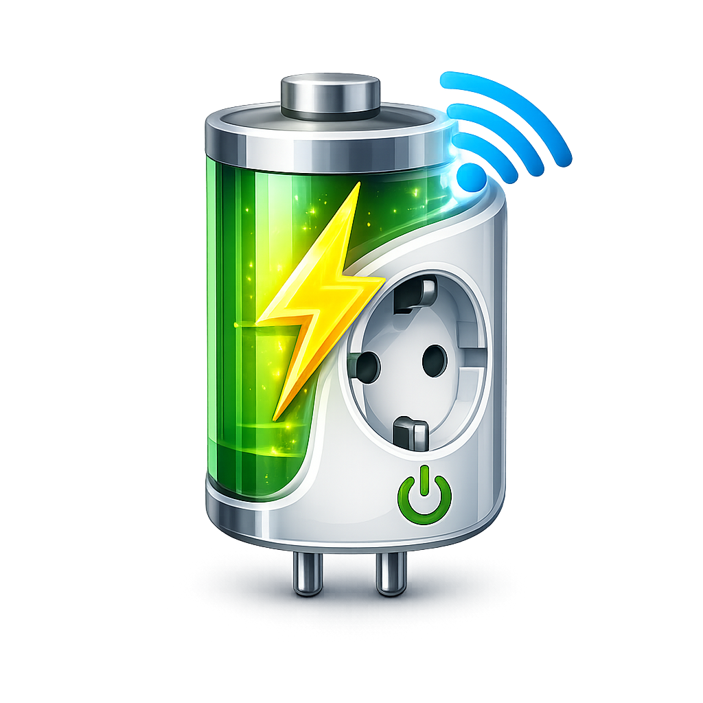
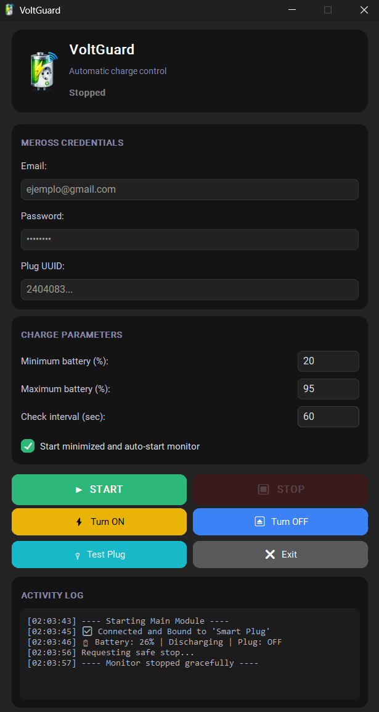

<div align="center">


# VoltGuard 🔋🔌

Automatic laptop charge control · Windows + Linux · v1.3.0


</div>

VoltGuard uses one Python codebase to read the laptop battery with `psutil` and control the **exact configured Meross smart plug**, through the Meross EU cloud. Internet and a supported single-outlet Meross plug are required. It does not change firmware or OS power profiles.

The default policy is **ON at or below 40% while disconnected from AC**, and **OFF at or above 95% while connected to AC**, checked every 60 seconds. In between, it leaves the relay alone. Missing battery readings, unknown AC status, offline devices and unknown relay state never trigger a power command. Commands are acknowledged, rate limited and retried at most three times per threshold crossing. Only one controller can run per user.

## Install or update

Download the distributions from [GitHub Releases](https://github.com/Yev94/voltguard/releases). CI artifacts are available on the [Actions page](https://github.com/Yev94/voltguard/actions) for branch builds. The old `Release/VoltGuard_Installer.exe` retained in the repository is **v1.0.0 for Windows**, not the current cross-platform installer.

### Windows

Run `VoltGuard_1.3.0_Windows_Setup.exe`. The installer offers login startup, enabled by default. It registers the installed application under the current user's `HKCU\Software\Microsoft\Windows\CurrentVersion\Run` with `--autostart`. No administrator access or Windows service is required. The panel opens visibly when that user signs in.

The existing `%APPDATA%\VoltGuard\config.json` location is retained. The first v1.1 load migrates old 15–85 or 20–95 limits to **40–95**, shows the panel and requires the charging plug to be verified again. The password stays in Windows Credential Locker. Normal subsequent settings edits are preserved.

### Linux (including KDE Plasma / Wayland)

Extract `VoltGuard-1.3.0-Linux.tar.gz`. On Ubuntu/Kubuntu install desktop dependencies if missing:

```bash
sudo apt install python3-venv python3-tk python3-gi python3-dbus gir1.2-ayatanaappindicator3-0.1
bash scripts/install-linux.sh
```

The installer copies only application code/assets into `${XDG_DATA_HOME:-~/.local/share}/voltguard/app` and installs dependencies in a sibling virtual environment using system Python. This location is stable and independent of the source checkout/worktree. No existing configuration, profile or installation is purged. Re-run the installer to update.

Open **VoltGuard** from the application menu. Per-user login startup is registered at `${XDG_CONFIG_HOME:-~/.config}/autostart/voltguard.desktop`. It opens the same visible panel; no background service or second implementation is created. The tray uses AppIndicator/Ayatana on Linux. If a usable tray cannot be created, the panel stays visible.

Passwords use the secure desktop keyring (KWallet / Secret Service); unlock the wallet privately if prompted. VoltGuard will not save a password into JSON or fall back to an insecure plaintext backend.

### Saved credentials across sessions

The OS wallet binding is stored as non-secret `credential_backend` metadata. On KDE, VoltGuard waits for KWallet instead of switching to Secret Service when KWallet starts a moment later. A locked or delayed wallet is retried with backoff; the panel stays in its existing visible/hidden state. A missing saved password and denied wallet access are reported separately and do not become repeated login/dialog attempts. Unlock the desktop wallet through its normal private UI if needed; do not reset the Meross password to fix a delayed wallet.

Saving settings or starting monitoring does **not** rewrite a loaded password. Only an explicit password edit or explicit legacy import writes the secret, to the same bound wallet. Existing entries and other applications' legacy wallet folders are not migrated or deleted.

If wallet loading is delayed at login -> keep the existing credential binding, wait for that wallet, and retry the read; never infer that the Meross password changed or copy a cached password to a different store.

## Configure and verify the charging plug

1. Enter your Meross email, password and the exact UUID of the plug powering this laptop. Password input is masked. Do not paste credentials into logs, issues or chat.
2. Keep the 40% / 95% limits or choose a valid range. **Save settings** stores the password in the OS keyring and the other settings in the user config file.
3. **Verify Plug** checks only the configured UUID and reads its model/status. It does **not** turn it on or off. Confirm in the local dialog that this is the laptop charger before enabling control. Changing email or UUID invalidates that confirmation.
4. **START** begins monitoring. **STOP** stops monitoring without changing the current relay state. Manual ON/OFF buttons remain available after verification.

**Encender cargador / Apagar cargador** work while automatic monitoring is running; no STOP/START cycle is needed. A manual request takes priority over an unsent automatic command and uses the monitor's existing connection. Only the two manual buttons are temporarily disabled while the request completes. Metrics and automatic checks continue, with at least **30 seconds** before automation can reverse a manual command; the normal battery/load rules apply afterwards. These buttons are momentary commands, not an indefinite manual override. They also work when monitoring is stopped and leave it stopped.

Queued manual requests expire after 30 seconds and are discarded if monitoring stops or the connection fails. A request is checked again after network reads before switching, so it cannot silently execute later after a stop/reconnection. Manual actions still require the exact charging plug to be confirmed and its relay state acknowledged. Starting monitoring during a standalone manual operation is deferred, preserving one connection owner.

The controls **Start charge monitoring automatically**, **Open panel at Windows / Linux login**, and **Hide window when opened manually** are independent. Login startup always opens the panel visibly. Closing the window hides it to the tray where supported; use **Exit** to stop the application.

### CPU / GPU performance assist

Enable **Keep charger ON during sustained load**, save settings and start monitoring. This is opt-in: updating the app preserves existing battery limits, credentials and the previous battery-only behavior until enabled. The same confirmed plug, acknowledgement, command cooldown and retry limit apply.

| Setting | Initial value |
| --- | --- |
| Enter assist | CPU **≥75% OR GPU ≥50%**, sustained for **15 seconds** |
| Leave assist | CPU **<35% AND GPU <40%**, continuously for **180 seconds** |
| Minimum powered time | **300 seconds** after acknowledged ON or observed AC |
| Sensor/control cadence while enabled | **5 seconds** |

All thresholds and dwell times are editable. A brief spike does not turn the charger on. While high load qualifies, an already connected charger is not cut at the battery maximum. Active assist keeps AC available even above the maximum; a smart plug cannot power the GPU while independently preventing battery charging. When load subsides, assist turns the plug off if no low-battery charge cycle remains. A cycle started at the minimum, or already charging when monitoring starts, continues to the battery maximum. STOP leaves the relay as it is.

Unknown battery/AC readings never issue commands. Missing/stale GPU or CPU readings never count as idle; an active override waits for both sensors to recover before disconnecting. There is no unlock, driver change, power-profile change or forced load test. CPU uses psutil; NVIDIA GPUs use a bounded, read-only `nvidia-smi` query (Windows/Linux); Linux AMD GPUs can use `gpu_busy_percent` from sysfs. The busiest supported GPU drives the threshold. Unsupported GPUs appear as **n/a**; do not enable automatic load release on such a system until GPU telemetry is available. The first nonblocking CPU sample is discarded.

The initial thresholds are practical starting values, not hardware limits. A 61-second passive sample on this RTX 4070 Laptop system (21 October 2026) observed CPU 2.1–16.1%, GPU 8–40%, clocks 210–315 MHz and GPU power 4.15–5.08 W, with AC present or unavailable. A later 20-minute trace with low clocks/watts showed GPU median 24% and 90th percentile 31%; the former GPU exit threshold of 20% never held for more than 15 seconds. The 40% exit default allows the idle dwell to complete under this measured light activity, while preserving the 50% entry threshold and both dwell timers. Existing profiles retaining the old 20% GPU exit setting need it adjusted in the panel. This puts the entry thresholds above that observed activity; it does not establish the cause of stutter or demonstrate battery-versus-AC performance. NVIDIA utilization measures activity during a sample interval, not frame-time smoothness ([NVIDIA device queries](https://docs.nvidia.com/deploy/nvml-api/latest/api/group__nvmlDeviceQueries.html)); the CPU initialization behavior is documented by [psutil](https://psutil.readthedocs.io/stable/index.html).

**Tracking:** while load assist monitoring runs, `load-telemetry.jsonl` in the normal log directory records timestamp, CPU/GPU usage, clocks, GPU watts, battery/AC, assist phase, decision reason and requested/acknowledged commands. Four rotating files cap storage at approximately **20 MB**. No email, password, device identifier, process list or cloud payload is recorded or uploaded. Local sampling continues during cloud connection failures, but it does not introduce new hardware commands or bypass verification.

Use **Mark stutter** when the screen stutters; it records the latest cached metrics and makes no relay command. **24h sensor report** compares battery/AC readings, shows confirmed switch counts and recent stutter marks. These are sampled diagnostics, not frame-time measurements or proof of causation. STOP/Exit stops sampling. To read the same report without starting the app or contacting Meross:

```bash
/path/to/voltguard/venv/bin/python -m src.load_report --hours 24
# Run from the installed app directory; optionally pass --path /path/to/history.jsonl.
```

If a new high-load episode occurs while an OFF command waits on the network -> cancel the OFF and require a new full idle dwell. Minimum ON time starts from confirmed power, never from the earlier threshold qualification.

A password inherited from a legacy plaintext project config may be migrated locally, without printing it:

```bash
/path/to/voltguard/venv/bin/python /path/to/voltguard/app/main.py --import-legacy /path/to/old/config.json
```

This imports the account/UUID, stores its password in the OS keyring, applies 40–95 and leaves hardware control unconfirmed. The original file remains untouched. Credentials are not synchronized between Windows and Linux; each OS uses its own secure wallet.

### User files

| File | Windows | Linux |
| --- | --- | --- |
| Non-secret settings | `%APPDATA%\VoltGuard\config.json` | `${XDG_CONFIG_HOME:-~/.config}/voltguard/config.json` |
| Rotating logs | `%APPDATA%\VoltGuard\voltguard.log` | `${XDG_STATE_HOME:-~/.local/state}/voltguard/voltguard.log` |
| Instance lock | Settings directory | Settings directory |

Logs avoid passwords, tokens and device UUIDs. A failed network connection retries with backoff; stopping or losing connectivity does not send a compensating ON/OFF command. The laptop must be awake, signed in and connected to the Internet for charge control to operate.

Displayed battery percentages are rounded to whole numbers (for example, `92 %`) in both the status and activity log. Charge decisions continue using the original precise reading. The panel opens once at login; monitoring refreshes do not show, raise or focus it. After hiding it, use the tray **Open** action to restore it.

## Development and validation

```bash
python -m pip install -r requirements.txt
python -m unittest discover -s tests -v
python main.py --demo          # harmless GUI preview; no account or switching
python main.py --smoke-test    # render preview and exit
python main.py                # normal application
```

When adding a battery display, use `src.presentation.battery_percentage`; never round the value passed to the charge policy. Preserve the virtualenv interpreter path in launchers instead of resolving its symlink.

On headless Linux, use `PYSTRAY_BACKEND=dummy xvfb-run -a python main.py --smoke-test`. The manual `test_meross.py` diagnostic is also read-only; it never selects a device by position.

GitHub Actions runs mocked battery/network tests and GUI smoke tests on **Windows and Ubuntu**. Windows CI also checks the native startup registry entry, builds with PyInstaller + Inno Setup and smoke-tests the packaged executable. Linux CI packages the shared source and native installer script. Version tags publish both distributions only after the jobs succeed. CI does not authenticate to a real Meross account or switch hardware. A physical Windows login and the next real Linux login remain separate operational checks.

To build Windows locally:

```powershell
python -m pip install -r requirements.txt 'pyinstaller>=6.16,<7'
python -m PyInstaller --noconfirm VoltGuard.spec
& 'C:\Program Files (x86)\Inno Setup 6\ISCC.exe' VoltGuard.iss
```
