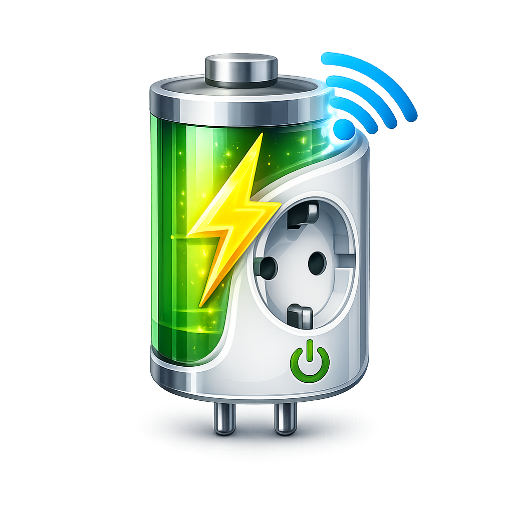
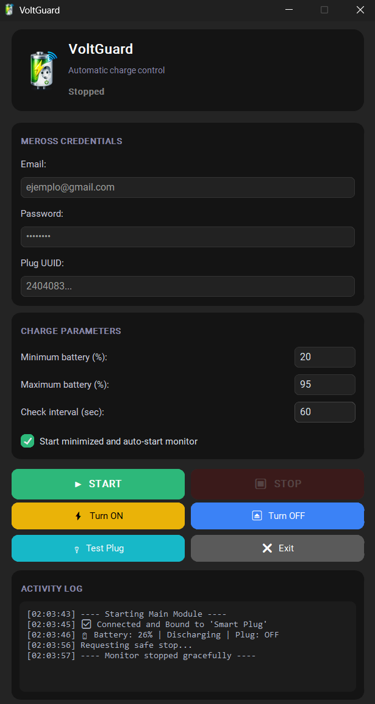

<div align="center">


# VoltGuard 🔋🔌

[](https://github.com/Yev94/voltguard/releases/tag/v1.0.0)



</div>

Native resident, asynchronous, modular Windows app: **monitors laptop battery** and switches a **Meross** smart plug at configurable thresholds. Designed for stability, persistent local connection and low resource use.

## 🚀 Key Features

* **MVC/asynchrony:** Backend reads (`meross-iot`, `psutil`) are decoupled from the `customtkinter` UI.
* **Resident mode:** Closing hides the app in the Windows tray (`pystray`); it continues running unattended.
* **Credentials:** Native Windows credential manager (`keyring`); the Meross password is never stored in local files or plaintext.
* **Network failures:** Suspends execution during Wi-Fi outages; log rotation limits disk spam from false network spikes.
* **Storage:** A fixed Windows-protected system directory avoids collisions between packaged executables.

---

## 💻 Requirements

Source dependencies (unneeded for a precompiled `.exe`):

```bash
pip install meross-iot psutil customtkinter pystray keyring pillow python-dotenv
```

> **OS Warning:** The telemetry logic is exclusively compiled drawing from the `psutil.sensors_battery()` engine.

---

## 📂 File Architecture

Separated components:

```text
📁 Project Root
├── 📄 main.py (Main entry point of the application)
│
└── 📁 src\
    ├── 📄 __init__.py 
    ├── 📄 logger_config.py (Atomic UTF-8 disk logging system)
    ├── 📄 config_manager.py (Model manager and Keyring Vault validation)
    ├── 📄 battery_backend.py (Background thread backend and Meross logic)
    └── 📄 ui_app.py (CustomTkinter block frontend and async callbacks)
```

### Persistent Paths
Default persistent directory:
> `C:\Users\YOUR_USER\AppData\Roaming\VoltGuard`

- `config.json`: Email, plug UUID and checking thresholds only.
- `voltguard.log`: Rotating log (~1 MB maximum, three disk slots, old logs deleted) for debugging UI failures.

---

## 🛠 Installation and Usage

**Precompiled installer:**
[👉 Download VoltGuard v1.0.0 Installer](https://github.com/Yev94/voltguard/releases/tag/v1.0.0)

**Run from source:**
1. Go to the project root.
2. Open a terminal.
3. Start it:

```bash
python main.py
```

4. First login: **email, password and plug UUID**. Set `% Min Battery`, `% Max Battery` and polling `Seconds`.

### Where do I find my Meross UUID?
Leave UUID blank, enter Meross email/password and click **🔌 Test Plug**. The Activity Log lists all linked devices and UUIDs; copy yours.

### Special Active Buttons:

- **🔌 Test Plug**: Tests frontend/backend asynchronous communication, latency and UUID by attempting to turn the plug ON for **2 seconds**, then OFF.
- **Start Minimized**: Starts the backend immediately without flashing the GUI; useful for Windows startup.

---

## 📦 How to Build and Package a Release

Build a Windows executable and installer:

1. **Compile the Executable using PyInstaller**
   You need the `pyinstaller` library installed. Run the following command in the project root:
   ```bash
   python -m PyInstaller --noconfirm VoltGuard.spec
   ```
   Generates standalone `dist/VoltGuard.exe`, including Python and assets specified by `.spec`.

2. **Generate the Windows Installer using Inno Setup**
   You will need [Inno Setup 6](https://jrsoftware.org/isinfo.php) installed on your system.
   - Open the file `VoltGuard.iss` with Inno Setup Compiler.
   - Click the **Compile** button (or press `Ctrl+F9`).
   - Alternatively, you can use the command line if Inno Setup is in your PATH. The default locations for `ISCC.exe` are usually:
     ```powershell
     & "C:\Program Files (x86)\Inno Setup 6\ISCC.exe" VoltGuard.iss
     ```
     *or if installed per-user:*
     ```powershell
     & "$env:LocalAppData\Programs\Inno Setup 6\ISCC.exe" VoltGuard.iss
     ```
   Packages the executable from `dist/` as `Release/VoltGuard_Installer.exe`.
